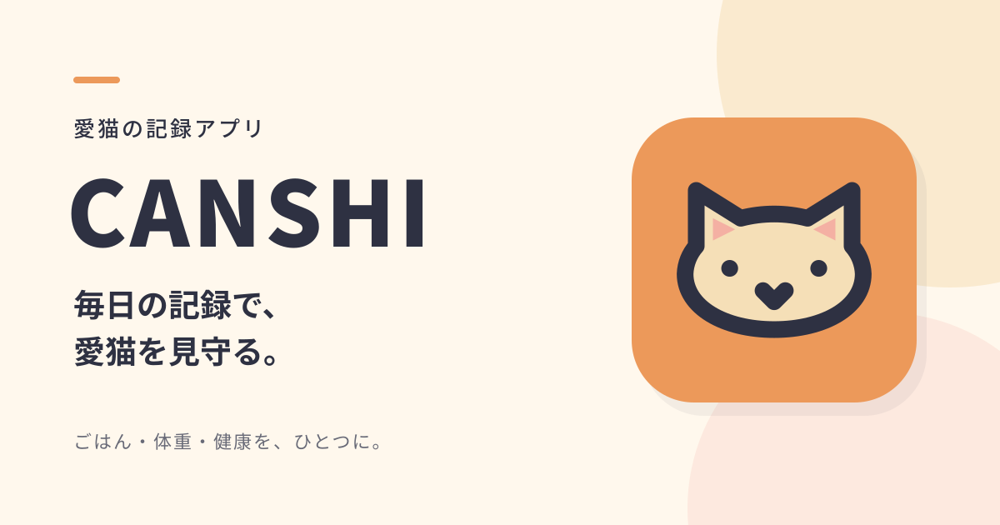

<h1 align="center">CANSHI</h1>

愛猫の日々の行動・健康状態・食事・通院などを記録する Web サービスです。PWA 対応で、スマートフォンからも快適に利用できます。

Cloudflare を利用して簡単にデプロイが可能です。

ChatGPT などの外部 AI エージェントからデータを参照できる MCP サーバーを
`/mcp` で公開しています（[`src/features/mcp`](src/features/mcp)）。自分で作ったプログラムなどから
トークンで使える API も `/api/v1` で公開しています（[`src/features/api`](src/features/api)）。

ユーザー・家などを確認できる運用者向けの管理画面を
[`packages/admin`](packages/admin) に同梱しています。メインアプリと管理画面などで共通の実装
（デザイントークン・UI コンポーネント）は [`packages/shared`](packages/shared) にまとめています。

## LICENSE

[MIT](./LICENSE)
